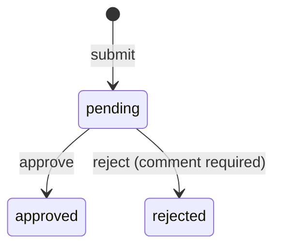

# Document Approval Workflow

Submitters send documents (text, a file, or both) for review. Reviewers approve or reject them, and submitters see the result along with the reviewer's comment.

**Stack:** Django 5.2 + Django REST Framework, SQLite, React 19 + TypeScript + Vite + Tailwind CSS.

- Live demo: https://springboard.devwatts.tech
- Video walkthrough: _TODO_

## Running it locally

You need Python 3.10+, Node 22.12+ and `make`.

```bash
make setup   # install dependencies and create the database
make dev     # backend on :8000, frontend on :5173
```

Open http://localhost:5173 and sign in with a test account. They're created by a migration, and the login page lists them under "Which account should I use?" (clicking one fills in the form):

| User  | Role      | Password        |
| ----- | --------- | --------------- |
| alice | submitter | `demo-pass-123` |
| carol | submitter | `demo-pass-123` |
| bob   | reviewer  | `demo-pass-123` |

Carol exists so you can check that submitters only see their own documents.

<details>
<summary>Without make</summary>

```bash
# Backend
cd backend
python3 -m venv .venv && source .venv/bin/activate
pip install -r requirements.txt
python manage.py migrate
python manage.py runserver

# Frontend (in a second terminal)
cd frontend
npm ci
npm run dev
```

</details>

The database and uploads are created under `backend/` and ignored by Git. Settings come from environment variables (`DJANGO_SECRET_KEY`, `DJANGO_DEBUG`, `DJANGO_ALLOWED_HOSTS`) with local-dev defaults.

## Tests

```bash
make test
```

This runs the backend suite (pytest) and the frontend suite (Vitest + Testing Library). The tests focus on the rules and flows that matter:

- `backend/tests/test_workflow.py`: the approve/reject rules, final states, and two reviewers acting at the same moment (exactly one wins, the other gets a conflict)
- `backend/tests/test_api.py`: submitting, validation, who can see and do what, filtering, conflicts, downloads
- `backend/tests/test_auth.py`: login
- `frontend/src/tests/`: API error handling, the submit form, and the approve/reject actions

Tests build the database straight from the models (`--nomigrations`), so they never depend on the seeded accounts. Uploads go to a temporary folder.

## Project layout

```
backend/
  config/                settings and root URLs
  accounts/              users, roles and login
    models.py            User with a role (submitter or reviewer)
    migrations/          schema, plus 0002 which seeds the test accounts
    permissions.py       IsSubmitter / IsReviewer
    views.py, urls.py    login, logout, me
  documents/
    models.py            Document
    services.py          the workflow rules: the only place a status changes
    serializers.py       input validation and response shapes
    views.py, urls.py    document endpoints
  tests/                 pytest suite
frontend/src/
  api/                   HTTP client and endpoint functions
  auth/                  login state (AuthContext)
  hooks/                 useDocuments: list plus status counts
  components/ui/         Button, Alert, Modal, StatusBadge, StatusTabs
  components/documents/  DocumentList, DocumentCard, SubmitForm, ReviewActions, ReviewOutcome
  pages/                 LoginPage, SubmitterPage, ReviewerPage
  lib/                   styles, formatting, form validation
  tests/                 Vitest suite
```

## API

Every endpoint except login needs an `Authorization: Token <token>` header. Interactive Swagger docs are at http://localhost:8000/api/docs/ (or `/api/docs/` on the live demo).

| Method | Path                            | Who               | What                                       |
| ------ | ------------------------------- | ----------------- | ------------------------------------------ |
| POST   | `/api/auth/login/`              | anyone            | Exchange username and password for a token |
| POST   | `/api/auth/logout/`             | signed in         | Invalidate the token                       |
| GET    | `/api/auth/me/`                 | signed in         | The current user                           |
| GET    | `/api/documents/?status=`       | signed in         | List documents (filter is optional)        |
| POST   | `/api/documents/`               | submitters        | Submit a document                          |
| GET    | `/api/documents/{id}/`          | owner or reviewer | One document                               |
| POST   | `/api/documents/{id}/review/`   | reviewers         | Approve or reject                          |
| GET    | `/api/documents/{id}/download/` | owner or reviewer | Download the attached file                 |
| GET    | `/api/documents/counts/`        | signed in         | Number of documents in each status         |

**Submit** (`multipart/form-data`):

```json
{ "title": "Q3 budget", "content": "Requesting $12k...", "file": "<optional upload>" }
```

**Review:**

```json
{ "decision": "approved" | "rejected", "comment": "required when rejecting" }
```

**A document in responses:**

```json
{
  "id": 1,
  "title": "Q3 budget",
  "content": "Requesting $12k...",
  "file_name": "budget.pdf",
  "status": "rejected",
  "submitted_by": { "id": 1, "username": "alice", "role": "submitter" },
  "reviewed_by": { "id": 2, "username": "bob", "role": "reviewer" },
  "review_comment": "Please add the cost breakdown.",
  "reviewed_at": "2026-11-18T10:30:00Z",
  "created_at": "2026-11-18T10:00:00Z"
}
```

While a document is pending, `reviewed_by` and `reviewed_at` are `null` and `review_comment` is empty. `file_name` is `null` when there's no attachment. The file's storage path is never exposed.

**Errors** use Django REST Framework's standard shapes: `{"detail": "..."}` for general errors, or `{"field": ["..."]}` for validation errors.

| Status | When                                                                                       |
| ------ | ------------------------------------------------------------------------------------------ |
| 400    | Invalid input: missing title, no content or file, bad file, invalid decision, reject without a comment |
| 401    | Missing or invalid token                                                                   |
| 403    | Wrong role, e.g. a submitter trying to review                                              |
| 404    | Not found, **or** another submitter's document                                             |
| 409    | The document was already reviewed                                                          |

### Why it's shaped this way

- **Review is an action (`POST /review/`), not `PATCH {status}`.** A generic status update would let a client send any status, including `pending`. A dedicated action takes only a decision, validates it, and records who reviewed the document and when, all in one step. There are no update or delete endpoints at all.
- **Status and review fields are read-only on submit.** Sending `"status": "approved"` when creating a document is ignored; the document always starts as pending.
- **409 Conflict for reviewing twice.** The request itself is valid; it just conflicts with the document's current state. The frontend uses it to refresh the list ("someone else got there first").
- **404 instead of 403 for other people's documents.** A submitter's queries only include their own documents, so the API doesn't reveal which IDs exist.
- **Downloads go through the API**, so the same permission check applies. Uploaded files are never publicly accessible.

## Decisions and trade-offs

**Data model.** `User` extends Django's built-in user with a single `role` field, which is the simplest thing that meets the requirements. `Document` stores the review outcome (`reviewed_by`, `reviewed_at`, `review_comment`) directly on the row, because there's exactly one review per document in this version. A database constraint guarantees every document has content or a file.

**Status transitions** all live in `documents/services.py`:



Approved and rejected are final. The allowed moves are a small table (`ALLOWED_TRANSITIONS`), which keeps the rules in one readable place.

**Two reviewers at once.** A review is saved with one conditional SQL update: "set the decision, but only if the document is still pending." If another reviewer got there first, the update matches no rows and the API returns a 409, so nobody's decision is silently overwritten. I used this instead of row locking (`select_for_update`) because SQLite doesn't support row locks; the conditional update is safe on SQLite and Postgres alike. A test runs two reviews at the same moment and checks that exactly one wins.

**Schema changes** are versioned with Django migrations (`*/migrations/`): each model change generates a numbered migration file that `migrate` applies in order.

**Trade-offs made for the 2-hour budget:**

- SQLite and local file storage. Both are a settings change away from Postgres and S3.
- Token auth, no sign-up flow. Tokens don't expire (logout deletes them), and the frontend keeps the token in localStorage. Fine for a demo; production would use expiring tokens in an httpOnly cookie.
- Test accounts are seeded by a data migration, which is fine for a demo but would be replaced by an invite flow in production.
- No pagination, and no live updates: the list refreshes on load, after an action, or when you switch filters.
- Uploads are checked by extension and size only, not by inspecting the contents.
- The upload rules (types and the 5 MB limit) are repeated in the frontend for instant feedback. The backend is still the source of truth.

## What I'd add for production

- Postgres, plus S3 (or similar) for files, with short-lived signed download URLs
- Pagination and search on the list endpoint
- A review history table (an audit log of every status change), which also enables resubmission and multi-step approvals
- Email or in-app notifications when a document is reviewed
- Virus scanning and content-type checks for uploads
- Expiring tokens, rate limiting on login, and a sign-up/invite flow
- CI that runs lint and tests on every push, structured logging, and error tracking

## AI tools used

I used Claude Code to scaffold the first draft from the brief, and as a pair programmer while building it out. I drove the design, scope and structure, trimmed what wasn't needed, and reviewed and tested every part myself. I also used Codex for a code review pass, which flagged the SQLite locking issue behind the conditional-update fix.
